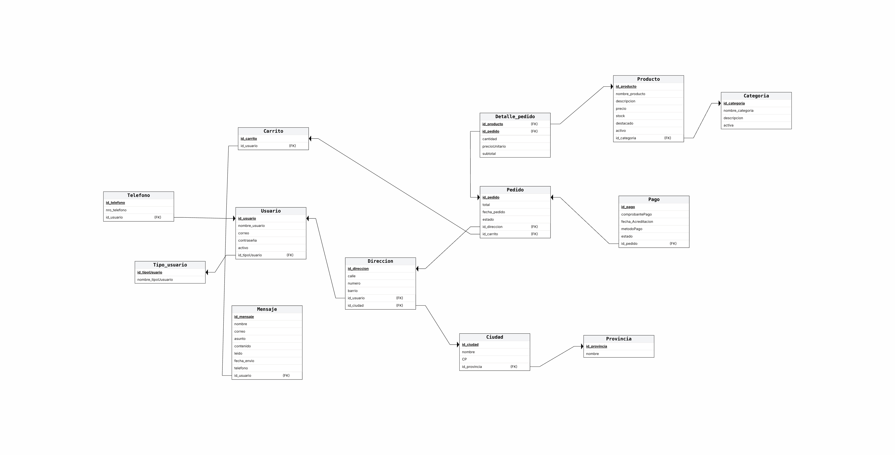

# Modelo Relacional

El modelo relacional corresponde a la transformación del Diagrama Entidad-Relación del sistema Energy.

En este modelo se representan las tablas del sistema, sus claves primarias (PK), claves foráneas (FK) y las relaciones existentes entre ellas.

## Archivos incluidos

- `Modelo-Relacional-3FN.png`: imagen del modelo relacional.
- `Modelo-Relacional-3FN.erdplus`: archivo editable generado en ERDPlus.

