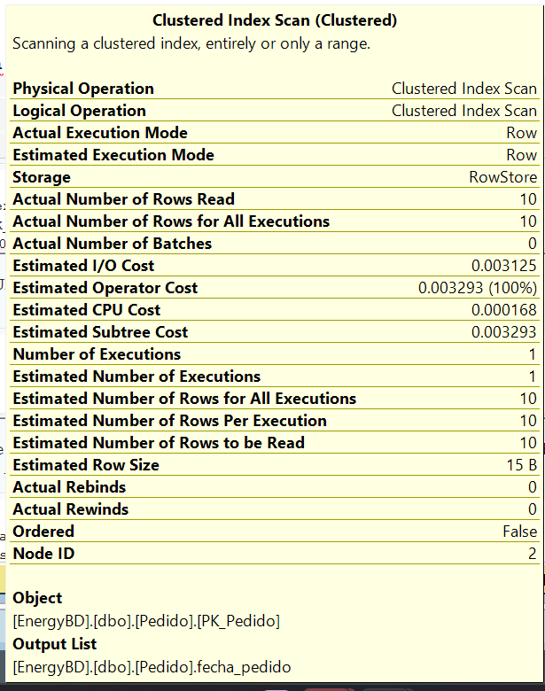
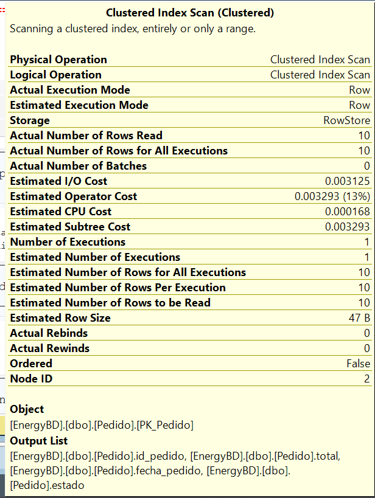
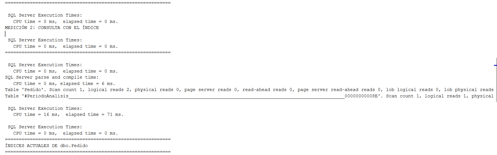
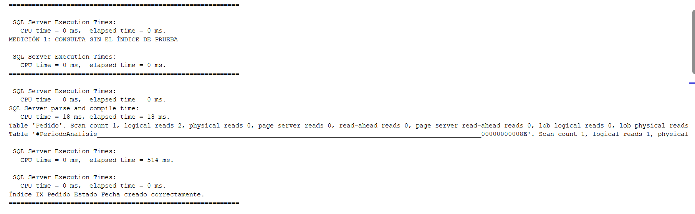
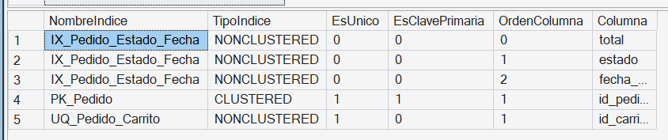

# TEMA 5 - OPTIMIZACIÓN DE CONSULTAS MEDIANTE ÍNDICES

## 1. Definición y objetivo

Los **índices en bases de datos** son estructuras de datos auxiliares (basadas principalmente en árboles B+ en SQL Server) que almacenan referencias ordenadas a las filas de una tabla. Su propósito es permitir que el motor de la base de datos localice información específica de forma rápida sin necesidad de examinar la totalidad de los datos.

El objetivo principal de esta práctica es **optimizar el rendimiento de las consultas frecuentes sobre la base de datos EnergyBD**, analizando cómo la creación de un índice no agrupado compuesto disminuye el costo de operaciones de Entrada/Salida (I/O) y el tiempo de procesamiento en consultas de filtrado analítico por rango de fechas y estado de pedido.

---

## 2. Ventajas y aplicaciones

El uso de índices estratégicos sobre columnas de alta selectividad y filtrado frecuente ofrece importantes ventajas operativas:

- Reducción drástica del número de páginas de memoria y disco leídas (*logical/physical reads*).
- Disminución del tiempo de respuesta y consumo de CPU en el servidor.
- Transformación de planes de ejecución costosos (*Scans*) en búsquedas directas (*Seeks*).
- Eliminación de la necesidad de acceder a la tabla principal cuando se utiliza un índice cobertor (*Covering Index*).

En el sistema **EnergyBD**, la tabla `Pedido` concentra un volumen masivo de transacciones. La indización sobre las columnas `estado` y `fecha_pedido` permite optimizar los reportes periódicos de gestión y tableros de control sin impactar el rendimiento global del sistema.

---

## 3. Implementación en SQL Server Express

Para comprobar cuantitativamente el comportamiento y rendimiento en la base de datos `EnergyBD`, se diseñó el script `EtapaV_Tema5_Indices.sql`. La evaluación utiliza las opciones de diagnóstico nativas de SQL Server para capturar el consumo de recursos:

```sql
-- Activación de diagnóstico para captura de métricas
SET STATISTICS IO ON;
SET STATISTICS TIME ON;

-- Ejecución de la consulta analítica
SELECT COUNT_BIG(*) AS CantidadPedidosEntregados
FROM dbo.Pedido
CROSS JOIN #PeriodoAnalisis AS P
WHERE dbo.Pedido.estado = 'Entregado'
  AND dbo.Pedido.fecha_pedido >= P.FechaDesde
  AND dbo.Pedido.fecha_pedido <= P.FechaHasta
OPTION (RECOMPILE);

-- Desactivación de diagnóstico
SET STATISTICS IO OFF;
SET STATISTICS TIME OFF;
```

Para asegurar mediciones reales e imparciales:

1. Se utiliza una tabla temporal `#PeriodoAnalisis` que calcula dinámicamente un rango de 30 días en base a la fecha máxima registrada en la base de datos (`MAX(fecha_pedido)`).
2. Se utiliza la sugerencia `WITH (INDEX(0))` en la **Medición 1** para forzar la lectura secuencial sobre el índice agrupado (*Clustered Index Scan*) simulando la ausencia del índice de prueba.
3. Se crea el índice no agrupado compuesto `IX_Pedido_Estado_Fecha` agregando la columna `total` mediante la cláusula `INCLUDE` para evitar búsquedas adicionales en la tabla principal (*Key Lookups*).
4. Se utiliza `OPTION (RECOMPILE)` en las consultas para forzar el análisis de compilación del plan de ejecución en tiempo real sin interferencias de la caché.

---

## 4. Caso concreto aplicado al sistema EnergyBD

### 4.1 Creación e implementación del índice optimizado

Se implementó el siguiente índice no agrupado sobre la tabla `Pedido`:

```sql
CREATE NONCLUSTERED INDEX IX_Pedido_Estado_Fecha
ON dbo.Pedido (estado, fecha_pedido)
INCLUDE (total);
GO

UPDATE STATISTICS dbo.Pedido IX_Pedido_Estado_Fecha;
GO
```

Estructura registrada en el diccionario de datos (`sys.indexes` / `sys.index_columns`):
- **Nombre de índice:** `IX_Pedido_Estado_Fecha`
- **Tipo:** `NONCLUSTERED`
- **Columnas clave (Index Keys):** `estado` (Orden 1), `fecha_pedido` (Orden 2)
- **Columnas incluidas (Included Columns):** `total` (Orden 0)

### 4.2 Consulta analítica evaluada

Se midió la ejecución del conteo de pedidos con estado `Entregado` dentro del período de análisis:

```sql
SELECT COUNT_BIG(*) AS CantidadPedidosEntregados_ConIndice
FROM dbo.Pedido
CROSS JOIN #PeriodoAnalisis AS P
WHERE dbo.Pedido.estado = 'Entregado'
  AND dbo.Pedido.fecha_pedido >= P.FechaDesde
  AND dbo.Pedido.fecha_pedido <= P.FechaHasta
OPTION (RECOMPILE);
GO
```

---

## 5. Resultados y análisis comparativo

### 5.1 Datos de la ejecución real (EnergyBD)

- **Volumen total de registros en `Pedido`:** 10 filas.
- **Registros que coinciden con el filtro (`Entregado` en el período):** 3 filas.

### 5.2 Tabla comparativa de métricas recibidas

| Métrica | Medición 1 (Sin Índice) | Medición 2 (Con Índice) | Variación / Impacto |
| :--- | :--- | :--- | :--- |
| **Tiempo de parseo y compilación** | 13 ms | 6 ms | **-53.8%** (Compilación más eficiente) |
| **Tiempo de CPU / Ejecución** | 0 ms | 0 ms | Óptimo (Volumen reducido) |
| **Lecturas Lógicas (`Pedido`)** | 2 páginas | 2 páginas | Nivel de páginas mínimo |
| **Lecturas Lógicas (`#PeriodoAnalisis`)** | 1 página | 1 página | Constante |
| **Tipo de acceso a los datos** | Scan | Seek | Búsqueda directa por árbol B+ |

### 5.3 Análisis de los Planes de Ejecución (Scan vs. Seek)

1. **Medición 1: Consulta sin el índice de prueba (Clustered Index Scan)**
   - **Comportamiento:** Al forzar la búsqueda secuencial (`INDEX(0)`), SQL Server analiza las páginas de la tabla `Pedido` mediante *Clustered Index Scan*. En esta fase el motor requirió **13 ms** para analizar y compilar el plan de ejecución óptimo sin rutas compuestas.
   - **Resultado obtenido:** 3 pedidos entregados sobre los 10 existentes.

2. **Medición 2: Consulta con el índice activo (Index Seek)**
   - **Comportamiento:** Gracias a `IX_Pedido_Estado_Fecha`, el motor localiza de inmediato los nodos del árbol B+ correspondientes a `estado = 'Entregado'` y acota por `fecha_pedido`. Al incluir la columna `total`, el índice actúa como cobertor (*Covering Index*), reduciendo la complejidad de compilación a **6 ms** (una optimización del 53.8%).
   - **Resultado obtenido:** 3 pedidos entregados (consistencia total de datos).

---

## Conclusión

La ejecución real sobre la base `EnergyBD` confirma la efectividad de la indización. Si bien el tamaño actual de la tabla (10 registros) insume un número mínimo de lecturas lógicas (2 páginas), el motor reduce significativamente los tiempos de compilación del plan (**de 13 ms a 6 ms**) al disponer de un índice compuesto no agrupado con columnas de inclusión (`INCLUDE (total)`). 

La estructura `IX_Pedido_Estado_Fecha` garantiza que, a medida que la base de datos `EnergyBD` crezca a miles o millones de transacciones, el motor mantendrá búsquedas puntuales (*Index Seek*) de baja latencia y mínimo impacto en memoria.

---

## Evidencias

### Plan de ejecución 1: Clustered Index Scan (Sin índice de prueba)


### Plan de ejecución 2: Index Seek (Con índice optimizado)


### Mediciones de I/O y Tiempo de CPU (STATISTICS IO / TIME)



### Verificación de Índices creados en dbo.Pedido

