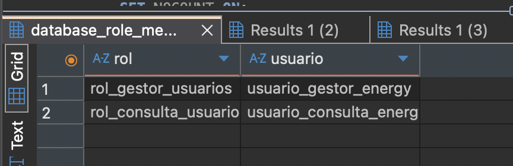
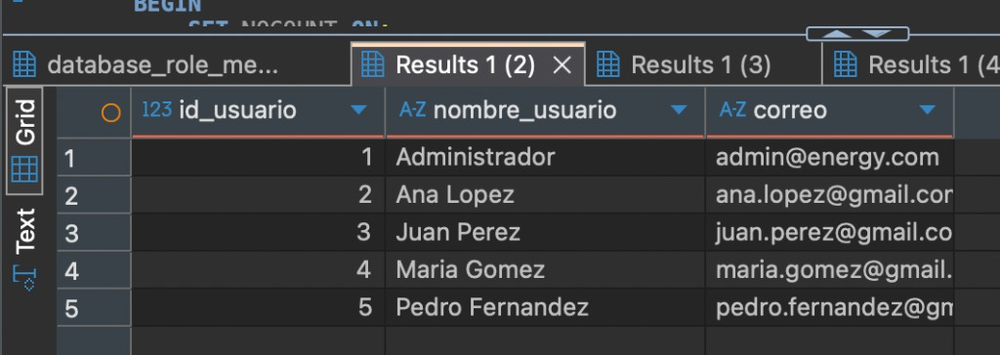
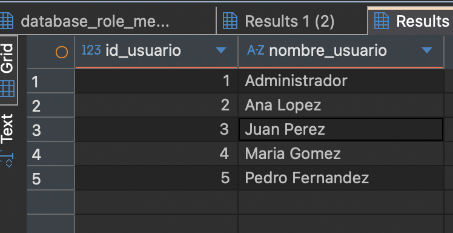
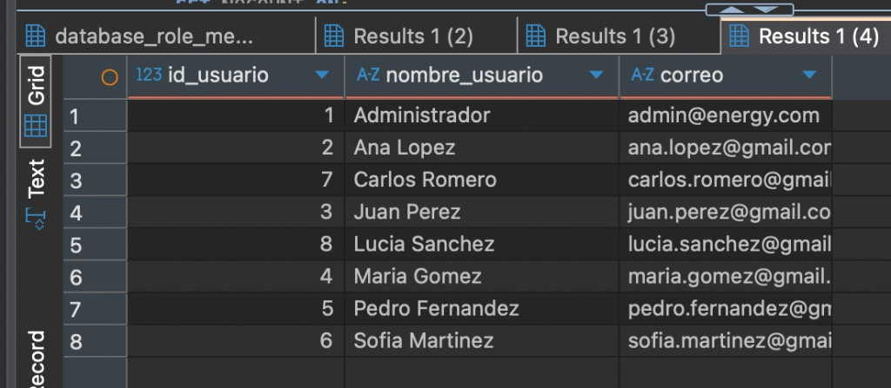
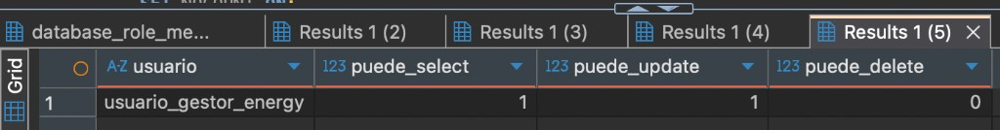
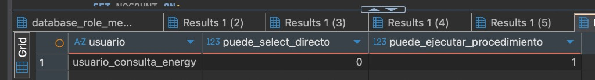

**Proyecto:** Energy - Equipo 45  
**Materia:** Bases de Datos I  
**Integrante:** Nair Nazer  

# Etapa V - Seguridad, usuarios, roles y permisos

### 3. Problemas o dificultades identificadas

**Detección de la entidad de paso Carrito:** Al auditar la estructura global de la base de datos, se detectó que la tabla Carrito opera esencialmente como una entidad "de paso", dado que únicamente almacena id_carrito e id_usuario sin poseer productos o ítems asociados. Se identificó que este esquema fue heredado y arrastrado a lo largo de las Etapas I, II, III y IV, provocando que la tabla Pedido se relacione con Carrito en lugar de apuntar directamente a Usuario.

**Dilema de refactorización en etapa avanzada:** Este inconveniente fue expuesto y debatido formalmente con los demás integrantes del equipo. Se analizó la posibilidad de suprimir la tabla Carrito o reestructurarla, pero se llegó a la conclusión unánime de mantenerla: encontrándonos en la Etapa V, eliminar dicha entidad implicaría reescribir y alterar el trabajo consolidado de todas las etapas previas (el DER y Modelo Relacional de la Etapa II, los scripts DDL y DML de la Etapa III, y las consultas analíticas de la Etapa IV).

**Evaluación de impacto funcional:** Se concluyó técnicamente que la presencia de Carrito no perjudica, no corrompe ni invalida el resultado final ni la lógica del sistema; simplemente introduce un paso intermedio adicional (un INNER JOIN extra) al momento de consultar o vincular las órdenes de compra con los usuarios.

### 4. Soluciones o propuestas realizadas

**Consenso técnico sobre Carrito:** Se acordó conservar la entidad en el esquema actual de la base de datos, evitando modificar los entregables de las etapas anteriores. Se documentó su funcionamiento como entidad intermedia, considerando que su presencia no afecta la lógica general del sistema.

**Implementación de seguridad mediante roles y permisos:** En mi parte de la Etapa V, desarrollé la seguridad de la base de datos EnergyBD utilizando la tabla Producto. Creé dos roles y dos usuarios de prueba, diferenciando las funciones de gestión de productos y consulta del catálogo.

**Asignación y restricción de permisos:** Implementé los comandos GRANT para otorgar permisos, DENY para restringir la eliminación de productos y REVOKE para demostrar cómo retirar un permiso previamente concedido.

**Procedimiento almacenado:** Creé un procedimiento almacenado destinado a consultar los productos activos, permitiendo realizar esta operación de manera organizada.

**Pruebas de seguridad:** Incorporé pruebas para comprobar las acciones permitidas y rechazadas según los permisos asignados a cada usuario, sin modificar los datos existentes. Estas pruebas quedaron incluidas en el archivo seguridad_roles_permisos.sql, para su verificación al ejecutarlo en SQL Server.

## Evidencias

### Roles y usuarios creados

### Consulta de usuarios

### Consulta de nombres

### Procedimiento de usuarios activos

### Permisos del gestor

El gestor puede consultar y actualizar. No puede eliminar: select 1, update 1, delete 0.

### Permisos del consultor

El consultor no tiene lectura directa de la tabla. Sí puede ejecutar el procedimiento: select directo 0, ejecutar procedimiento 1.

