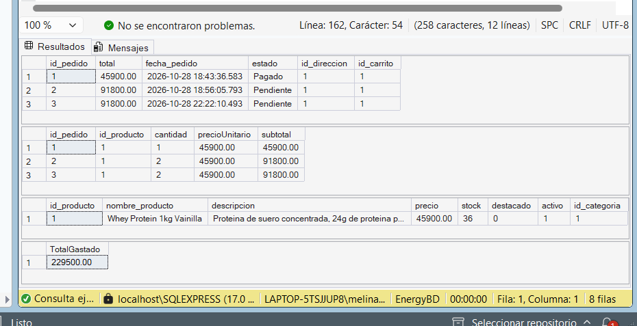
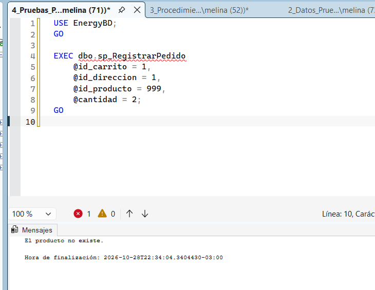
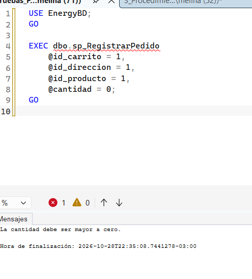
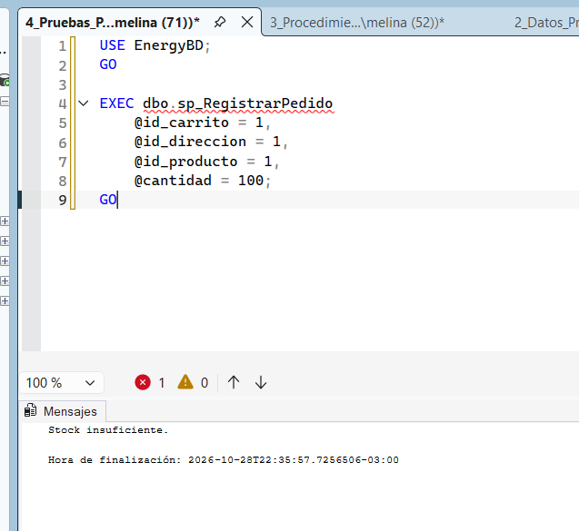

# TEMA 1 - PROCEDIMIENTOS Y FUNCIONES ALMACENADAS

## 1. Definición y objetivo

Los **procedimientos almacenados** son programas SQL que se guardan dentro de la base de datos y permiten ejecutar una o varias operaciones de manera organizada.

Pueden recibir parámetros y realizar acciones como insertar, modificar, eliminar o consultar información.

Las **funciones almacenadas** son rutinas que también se almacenan dentro de la base de datos, reciben parámetros y devuelven un resultado que puede utilizarse posteriormente dentro de otras consultas SQL.

El objetivo principal de ambos mecanismos es **centralizar parte de la lógica del sistema dentro de la base de datos**, evitando repetir consultas y permitiendo reutilizar operaciones.

---

## 2. Ventajas y aplicaciones

El uso de procedimientos y funciones almacenadas presenta varias ventajas:

- Permiten reutilizar código SQL.
- Reducen la repetición de consultas.
- Facilitan el mantenimiento de la base de datos.
- Centralizan determinadas reglas del sistema.
- Permiten trabajar con parámetros.
- Facilitan la ejecución de varias operaciones mediante una sola llamada.
- Ayudan a organizar las operaciones realizadas sobre la base de datos.

En el sistema **EnergyBD**, estos mecanismos pueden utilizarse para registrar pedidos, actualizar el stock de los productos y calcular el total gastado por un usuario.

---

## 3. Implementación en SQL Server Express

Para implementar este tema en **SQL Server Express** se creó una función almacenada y un procedimiento almacenado sobre la base de datos `EnergyBD`.

### Función almacenada

Se creó la función:

`dbo.fn_TotalGastadoUsuario`

Esta función recibe como parámetro el identificador de un usuario y calcula el importe total correspondiente a sus pedidos, sin considerar aquellos cuyo estado sea `Cancelado`.

### Procedimiento almacenado

Se creó el procedimiento:

`dbo.sp_RegistrarPedido`

Este procedimiento recibe los siguientes parámetros:

- ID del carrito.
- ID de la dirección.
- ID del producto.
- Cantidad solicitada.

El procedimiento realiza las siguientes operaciones:

1. Busca el precio y el stock del producto.
2. Verifica que el producto exista.
3. Verifica que la cantidad ingresada sea válida.
4. Comprueba que exista stock suficiente.
5. Calcula el total del pedido.
6. Registra el pedido.
7. Registra el detalle del pedido.
8. Descuenta del stock las unidades vendidas.

---

## 4. Caso concreto aplicado al sistema EnergyBD

### 4.1 Función `fn_TotalGastadoUsuario`

Se implementó la siguiente función:

```sql
CREATE OR ALTER FUNCTION dbo.fn_TotalGastadoUsuario
(
    @id_usuario INT
)
RETURNS DECIMAL(12,2)
AS
BEGIN

    DECLARE @totalGastado DECIMAL(12,2);

    SELECT @totalGastado = ISNULL(SUM(p.total), 0)
    FROM Pedido AS p
    INNER JOIN Carrito AS c
        ON p.id_carrito = c.id_carrito
    WHERE c.id_usuario = @id_usuario
      AND p.estado <> 'Cancelado';

    RETURN @totalGastado;

END;
GO
```

Para probar la función se ejecutó:

```sql
SELECT dbo.fn_TotalGastadoUsuario(1) AS TotalGastado;
```

El primer resultado obtenido fue:

```text
45900.00
```

Esto indica que inicialmente el usuario tenía pedidos por un total de **$45.900**.

---

### 4.2 Procedimiento `sp_RegistrarPedido`

Se implementó el siguiente procedimiento almacenado:

```sql
CREATE OR ALTER PROCEDURE dbo.sp_RegistrarPedido
    @id_carrito INT,
    @id_direccion INT,
    @id_producto INT,
    @cantidad INT
AS
BEGIN

    DECLARE @precio DECIMAL(10,2);
    DECLARE @stock INT;
    DECLARE @total DECIMAL(10,2);
    DECLARE @id_pedido INT;

    SELECT
        @precio = precio,
        @stock = stock
    FROM Producto
    WHERE id_producto = @id_producto;

    IF @precio IS NULL
    BEGIN
        PRINT 'El producto no existe.';
        RETURN;
    END;

    IF @cantidad <= 0
    BEGIN
        PRINT 'La cantidad debe ser mayor a cero.';
        RETURN;
    END;

    IF @stock < @cantidad
    BEGIN
        PRINT 'Stock insuficiente.';
        RETURN;
    END;

    SET @total = @precio * @cantidad;

    INSERT INTO Pedido (
        total,
        fecha_pedido,
        estado,
        id_direccion,
        id_carrito
    )
    VALUES (
        @total,
        GETDATE(),
        'Pendiente',
        @id_direccion,
        @id_carrito
    );

    SET @id_pedido = SCOPE_IDENTITY();

    INSERT INTO Detalle_pedido (
        id_pedido,
        id_producto,
        cantidad,
        precioUnitario,
        subtotal
    )
    VALUES (
        @id_pedido,
        @id_producto,
        @cantidad,
        @precio,
        @total
    );

    UPDATE Producto
    SET stock = stock - @cantidad
    WHERE id_producto = @id_producto;

    PRINT 'Pedido registrado correctamente.';

END;
GO
```

Para comprobar su funcionamiento se ejecutó:

```sql
EXEC dbo.sp_RegistrarPedido
    @id_carrito = 1,
    @id_direccion = 1,
    @id_producto = 1,
    @cantidad = 2;
GO
```

---

## 5. Resultados obtenidos

La ejecución del procedimiento permitió registrar correctamente un nuevo pedido.

El producto utilizado tenía un precio unitario de **$45.900** y se solicitaron **2 unidades**.

Por lo tanto, el nuevo pedido se registró con un total de:

```text
$91.800
```

El detalle del pedido quedó registrado con los siguientes valores:

- **Cantidad:** 2 unidades.
- **Precio unitario:** $45.900.
- **Subtotal:** $91.800.

El producto tenía inicialmente un stock de **40 unidades**.

Luego de ejecutar el procedimiento, el stock disminuyó correctamente a:

```text
38 unidades
```

Finalmente, se volvió a ejecutar la función:

```sql
SELECT dbo.fn_TotalGastadoUsuario(1) AS TotalGastado;
```

El resultado obtenido fue:

```text
137700.00
```

Esto corresponde a:

```text
45900 + 91800 = 137700
```

De esta manera se comprobó que tanto la **función almacenada** como el **procedimiento almacenado** funcionan correctamente sobre la base de datos `EnergyBD`.

---

## Conclusión

La implementación de procedimientos y funciones almacenadas permitió centralizar operaciones importantes del sistema dentro de la base de datos.

La función `fn_TotalGastadoUsuario` permite obtener de manera reutilizable el total gastado por un usuario.

Por otra parte, el procedimiento `sp_RegistrarPedido` permite registrar un pedido junto con su detalle y actualizar automáticamente el stock del producto.

El uso de estos mecanismos permite reducir la repetición de código, organizar las operaciones SQL y facilitar el mantenimiento del sistema.


## Evidencias

### Prueba exitosa



### Error: producto inexistente



### Error: cantidad inválida



### Error: stock insuficiente

