# TEMA: TRIGGERS DE AUDITORÍA Y CONTROL DE OPERACIONES (ETAPA V)

**Integrante:** Daniela Mormina  
**Materia:** Base de Datos I - UNNE  
**Sistema:** EnergyBD (E-Commerce de Suplementos Nutricionales)  
**Motor SGBD:** Microsoft SQL Server 2022 Express  

---

## 1. Definición y Objetivo

Los **triggers** (o *disparadores*) son programas SQL especiales que se almacenan dentro de la base de datos y se ejecutan de manera automática ante la ocurrencia de un evento de manipulación de datos (sentencias DML: `INSERT`, `UPDATE` o `DELETE`).

A diferencia de los procedimientos almacenados, que requieren ser invocados explícitamente mediante una instrucción `EXEC`, los triggers son disparados por el propio motor de base de datos de forma obligatoria, transparente e ineludible para el usuario o aplicación que emite la orden.

### 1.1 Tipos de Triggers DML en SQL Server
* **Triggers `AFTER` (o `FOR`):** Se ejecutan **después** de que la instrucción DML que los originó haya impactado físicamente en la tabla y se hayan validado todas las restricciones declarativas (`PRIMARY KEY`, `FOREIGN KEY`, `CHECK`). Son los mecanismos indicados para **auditoría histórica, trazabilidad y sincronización de datos**.
* **Triggers `INSTEAD OF`:** Se ejecutan **en lugar de** la instrucción DML que los activó, sustituyendo la acción por defecto del motor. Son fundamentales para implementar **reglas de negocio avanzadas, transformación de borrados físicos a lógicos (*soft delete*) y bloqueos de seguridad mediante cancelación con error**.

### 1.2 Mecanismo Interno: Tablas Virtuales `inserted` y `deleted`
Durante la ejecución de un trigger, SQL Server gestiona dos tablas virtuales residentes en memoria con idéntica estructura a la tabla sobre la cual se define el disparador:
* **Tabla `inserted`:** Contiene las nuevas filas agregadas ante un `INSERT` o las nuevas versiones de las filas modificadas ante un `UPDATE`. Ante un `DELETE` permanece vacía.
* **Tabla `deleted`:** Contiene las filas removidas ante un `DELETE` o las versiones previas de las filas antes de su alteración ante un `UPDATE`. Ante un `INSERT` permanece vacía.

El objetivo central de este tema es **centralizar en el motor de bases de datos la seguridad, la trazabilidad inalterable y la integridad referencial del sistema**, garantizando que ninguna operación crítica quede sin registrar o viole las reglas del dominio de negocio.

---

## 2. Ventajas y Aplicaciones

La implementación de disparadores en el sistema **EnergyBD** aporta las siguientes ventajas arquitectónicas:

* **Trazabilidad y No Repudio:** Permite responder con certeza forense *quién* (`SYSTEM_USER`), *cuándo* (`GETDATE()`), *desde qué equipo* (`HOST_NAME()`) y *qué valor exacto* modificó en datos sensibles (como precios de venta, stock o estados de pedidos).
* **Independencia de la Capa de Aplicación:** La auditoría reside en el núcleo del SGBD. Si un administrador o un desarrollador ejecuta consultas directas desde un cliente SQL (como DBeaver o Management Studio) o a través de un servicio backend, los triggers se disparan sin excepción.
* **Preservación del Historial Contable (Soft Delete Automático):** Evita la destrucción accidental de registros maestros transformando sentencias `DELETE` en actualizaciones lógicas (`activo = 0`).
* **Protección Preventiva de la Integridad:** Impide borrados que dejarían huérfanos registros transaccionales dependientes, complementando las restricciones de integridad declarativas.

---

## 3. Implementación en SQL Server Express y Decisiones Técnicas

En **SQL Server Express**, los disparadores operan dentro de la misma transacción que la sentencia que los invocó. Si el trigger ejecuta una instrucción `ROLLBACK TRANSACTION`, se aborta la totalidad de la operación.

Para asegurar una implementación eficiente y acorde a las mejores prácticas de la industria, se adoptaron tres criterios técnicos fundamentales:

### A) Enfoque Basado en Conjuntos (*Set-Based Operations*)
Los triggers en SQL Server no se ejecutan una vez por cada fila, sino **una sola vez por cada sentencia ejecutada**, sin importar si la instrucción afectó a una o a mil filas. Por este motivo, la lógica interna se diseñó utilizando `INNER JOIN` entre las tablas lógicas `inserted` y `deleted` y la tabla base, descartando el uso de cursores o variables escalares que degradarían el rendimiento.

### B) Justificación de la Auditoría Selectiva mediante `IF UPDATE(columna)`
En sistemas OLTP de alta concurrencia, intentar auditar la totalidad de las columnas ante cada `UPDATE` constituye un anti-patrón de diseño (*Over-Auditing*) que produce una severa saturación del registro de transacciones (*Transaction Log* o archivo `.ldf`) y genera contención de bloqueos (*locks*).
* **Evaluación en memoria a costo cero:** La función `UPDATE(columna)` consulta la máscara de bits en memoria (*column update mask*) que el motor genera en el plan de ejecución. Si la columna en cuestión no fue alterada, el bloque del trigger ni siquiera se procesa.
* **Foco en atributos críticos de negocio:** Se auditan únicamente campos con impacto financiero, logístico o de seguridad:
  * En `Producto`: `precio` (evita fraudes y alteraciones en ventas) y `stock` (control de inventario).
  * En `Pedido`: `estado` (ciclo de vida de la orden) y `total` (importe facturado).
  * En `Usuario`: `correo` (identidad de acceso) e `id_tipoUsuario` (privilegios de rol).
  * Campos puramente descriptivos (como el texto de una descripción o comentarios) no generan ruido innecesario en la auditoría.

### C) Supresión de Mensajes de Conteo (`SET NOCOUNT ON`)
Se incluye al inicio de cada trigger para evitar que el motor envíe al cliente los mensajes con la cantidad de filas afectadas por las operaciones internas de auditoría, optimizando el tráfico de red.

---

## 4. Caso Concreto Aplicado al Sistema EnergyBD

El modelo de datos de **EnergyBD** presenta dos tipologías de entidades claramente diferenciadas, por lo que se diseñó una **estrategia de auditoría y control dual**:

```
                                  [ EVENTO DML ]
                                         │
                 ┌───────────────────────┼──────────────────────┐
                 ▼                       ▼                      ▼
             [ INSERT ]              [ UPDATE ]             [ DELETE ]
                 │                       │                      │
                 │                       │           ┌──────────┴──────────┐
                 │                       │           ▼                     ▼
                 │                       │      Tablas con 'activo'   Tablas sin 'activo'
                 │                       │    (Producto/Usuario/Cat)    (Pedido/Pago)
                 │                       │           │                     │
                 │                       │      INSTEAD OF            INSTEAD OF
                 │                       │           ▼                     ▼
                 │                       │      Soft Delete         ROLLBACK + Error
                 │                       │     (activo = 0)         (Bloqueo total)
                 ▼                       ▼           │
            Auditoría de            Auditoría de     │
           Alta de Registro        Campos Críticos   │
                 │                       │           │
                 └───────────────────────┴───────────┴──────────┐
                                                                ▼
                                                   [ dbo.Auditoria_Sistema ]
```

### 4.1 Estructura: Tabla `Auditoria_Sistema`
Centraliza la trazabilidad en una estructura única y normalizada:

```sql
CREATE TABLE dbo.Auditoria_Sistema (
    id_auditoria INT IDENTITY(1,1) NOT NULL,
    tabla_afectada VARCHAR(50) NOT NULL,
    operacion VARCHAR(20) NOT NULL,               -- 'INSERT', 'UPDATE', 'SOFT_DELETE'
    id_registro VARCHAR(50) NOT NULL,
    campo_modificado VARCHAR(50) NOT NULL,
    valor_anterior VARCHAR(MAX) NULL,
    valor_nuevo VARCHAR(MAX) NULL,
    fecha DATETIME NOT NULL DEFAULT GETDATE(),
    usuario VARCHAR(100) NOT NULL DEFAULT SYSTEM_USER,
    terminal VARCHAR(100) NULL DEFAULT HOST_NAME(),
    CONSTRAINT PK_Auditoria_Sistema PRIMARY KEY (id_auditoria)
);
```

### 4.2 Matriz de Triggers Desarrollados

| Categoría | Trigger | Tabla | Evento | Comportamiento y Regla de Negocio |
| :--- | :--- | :--- | :---: | :--- |
| **Auditoría** | `trg_Auditoria_Producto_InsertUpdate` | `Producto` | `AFTER INSERT, UPDATE` | Registra altas y audita variaciones en `precio` y `stock`. |
| **Auditoría** | `trg_Auditoria_Pedido_Update` | `Pedido` | `AFTER UPDATE` | Audita transiciones de `estado` y modificaciones en `total`. |
| **Auditoría** | `trg_Auditoria_Usuario_Update` | `Usuario` | `AFTER UPDATE` | Audita cambios en `correo` o perfil de acceso (`id_tipoUsuario`). |
| **Soft Delete** | `trg_Producto_SoftDelete` | `Producto` | `INSTEAD OF DELETE` | Intercepta el borrado, aplica `activo = 0` y audita la baja lógica. |
| **Soft Delete** | `trg_Usuario_SoftDelete` | `Usuario` | `INSTEAD OF DELETE` | Intercepta el borrado, aplica `activo = 0` y protege compras previas (RN01). |
| **Soft Delete** | `trg_Categoria_SoftDelete` | `Categoria` | `INSTEAD OF DELETE` | Intercepta el borrado, aplica `activa = 0` y audita la baja (RN02). |
| **Bloqueo** | `trg_Pedido_PrevenirEliminacion` | `Pedido` | `INSTEAD OF DELETE` | Bloquea la eliminación con `RAISERROR` y ejecuta `ROLLBACK`. |
| **Bloqueo** | `trg_Pago_PrevenirEliminacion` | `Pago` | `INSTEAD OF DELETE` | Bloquea la eliminación de comprobantes financieros con `ROLLBACK`. |

---

## 5. Script de Demostración y Resultados Obtenidos

Para validar la solución en **SQL Server 2022 Express** a través de **DBeaver**, se ejecutó la suite de pruebas contenida en `scripts.sql`:

### Caso 1: Alta de Producto (INSERT)
```sql
INSERT INTO dbo.Producto (nombre_producto, descripcion, precio, stock, destacado, activo, id_categoria)
VALUES ('Shaker Pro 700ml', 'Vaso mezclador con compartimento para suplementos', 8500.00, 50, 0, 1, 8);
```
* **Resultado:** El trigger `trg_Auditoria_Producto_InsertUpdate` detectó la inserción y registró en `Auditoria_Sistema` la operación `INSERT` con los valores iniciales de precio, stock y estado.

### Caso 2: Modificación de Precio y Stock (UPDATE)
```sql
UPDATE dbo.Producto
SET precio = 9200.00, stock = 45
WHERE nombre_producto = 'Shaker Pro 700ml';
```
* **Resultado:** El trigger evaluó mediante `UPDATE(precio)` y `UPDATE(stock)` las dos columnas afectadas e insertó dos registros de auditoría:
  * `PRECIO`: anterior `$8500.00` → nuevo `$9200.00`.
  * `STOCK`: anterior `50` → nuevo `45`.

### Caso 3: Eliminación en Tablas con 'activo' (Soft Delete Automático)
```sql
-- En Producto:
DELETE FROM dbo.Producto WHERE nombre_producto = 'Shaker Pro 700ml';

-- En Usuario:
DELETE FROM dbo.Usuario WHERE id_usuario = 8;
```
* **Resultado:** Los triggers `INSTEAD OF DELETE` interceptaron ambas sentencias. Ningún registro fue eliminado físicamente; ambos pasaron a `activo = 0` y se generaron las entradas correspondientes con la operación `SOFT_DELETE` en la tabla de auditoría.

### Caso 4: Eliminación en Tablas sin 'activo' (Bloqueo y Rollback)
```sql
DELETE FROM dbo.Pedido WHERE id_pedido = 1;
```
* **Resultado:** El trigger `trg_Pedido_PrevenirEliminacion` interceptó el intento de borrado, canceló la acción mediante `ROLLBACK TRANSACTION` y emitió el mensaje de error:
  > *Msg 50000: Operación cancelada: No está permitida la eliminación física de registros en la tabla Pedido por motivos de integridad transaccional y contable. Para anular una venta debe actualizarse su estado a 'Cancelado'.*
* El pedido número 1 permaneció inalterado.

### Caso 5: Modificación de Estado de Compra en Pedido (UPDATE)
```sql
UPDATE dbo.Pedido
SET estado = 'Pagado'
WHERE id_pedido = 6;
```
* **Resultado:** Se auditó con éxito la transición de `Pendiente` a `Pagado`, registrando el usuario ejecutor y la marca de tiempo exacta.

---

## 6. Evidencias Gráficas (Capturas de DBeaver)

A continuación se presentan las 11 capturas de pantalla obtenidas durante la ejecución de las pruebas en **DBeaver** conectado a la base de datos `EnergyBD` (SQL Server 2022 Express en Docker), donde se observa la terminal registrada como `DanyMormina`:

### 6.1 Auditoría de Inserción (INSERT)
Demostración del alta del nuevo producto en el catálogo y su registro automático inmediato en la tabla `Auditoria_Sistema`:
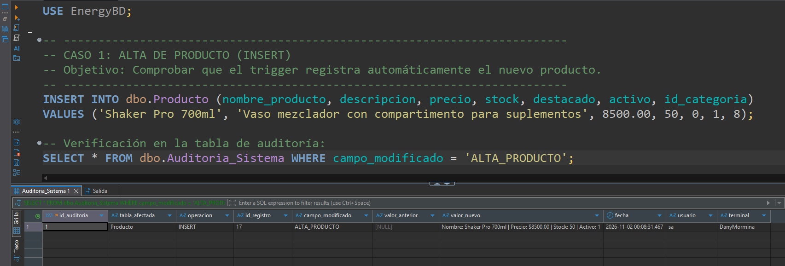

### 6.2 Auditoría de Modificaciones de Precio y Stock (UPDATE)
Actualización simultánea de precio y stock, verificando que el trigger registra dos entradas independientes con sus respectivos valores anteriores y nuevos:
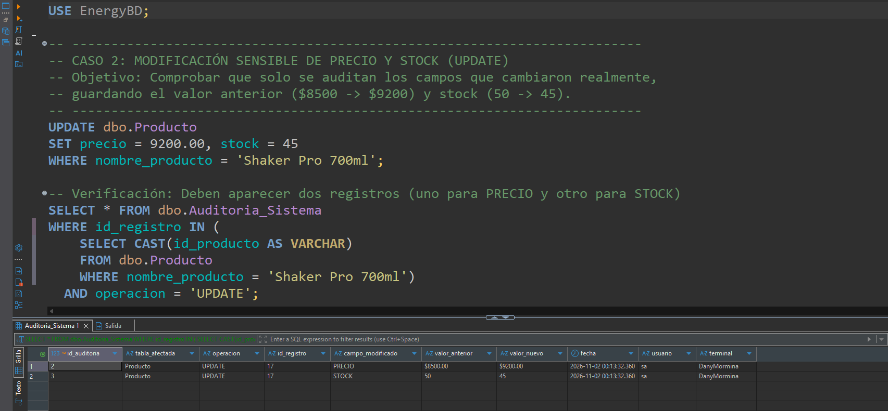

### 6.3 Conversión de Eliminación a Borrado Lógico (Soft Delete)
Demostración de la intercepción de sentencias `DELETE` en tablas con atributo `activo`:
* **En tabla Producto:** Comprobación de que el registro no se elimina físicamente, sino que su estado pasa a `activo = 0`:
  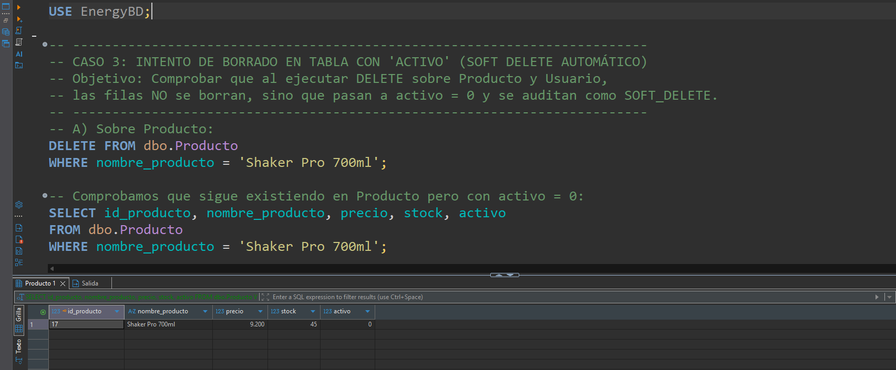
* **En tabla Usuario:** Desactivación lógica de la cuenta sin romper la integridad referencial de compras previas:
  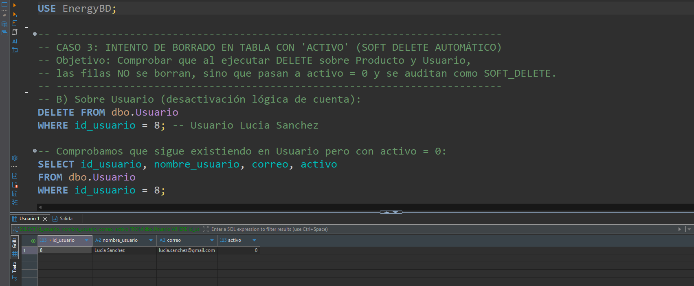
* **Comprobación en Auditoría:** Verificación en `Auditoria_Sistema` de las dos operaciones registradas bajo el tipo `SOFT_DELETE`:
  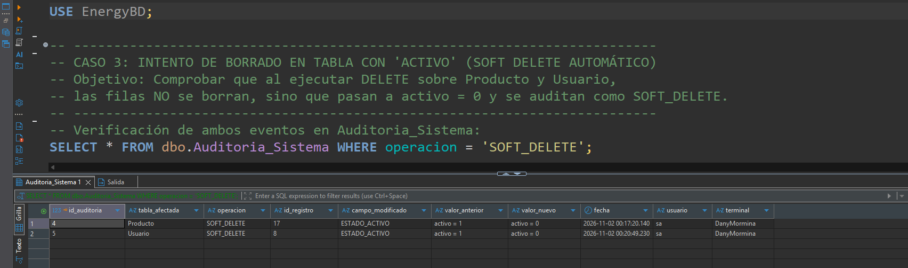

### 6.4 Bloqueo de Eliminación y Rollback en Tablas Transaccionales
Demostración del control de integridad en tablas sin borrado lógico:
* **En tabla Pedido:** Emisión de mensaje de error descriptivo (Msg 50000) y cancelación de la transacción ante intento de `DELETE`:
  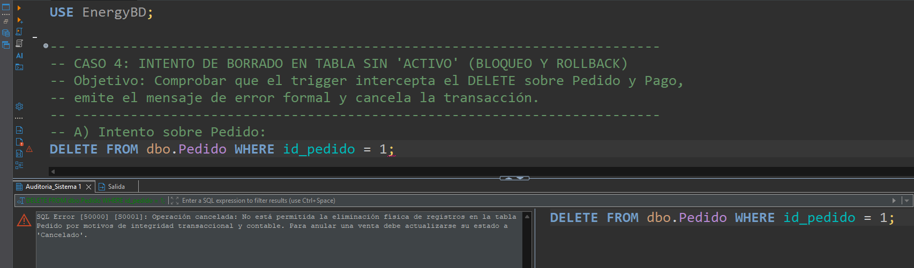
* **Comprobación de Integridad en Pedido:** Consulta que verifica que el pedido permanece inalterado en la base de datos:
  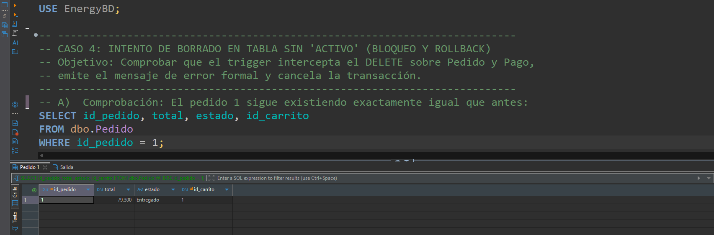
* **En tabla Pago:** Bloqueo y cancelación con rollback ante intento de eliminación de comprobantes de pago:
  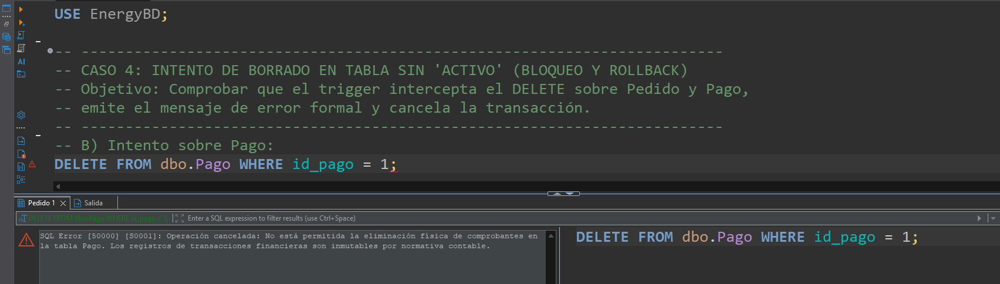
* **Comprobación de Integridad en Pago:** Verificación de que el comprobante financiero permanece intacto:
  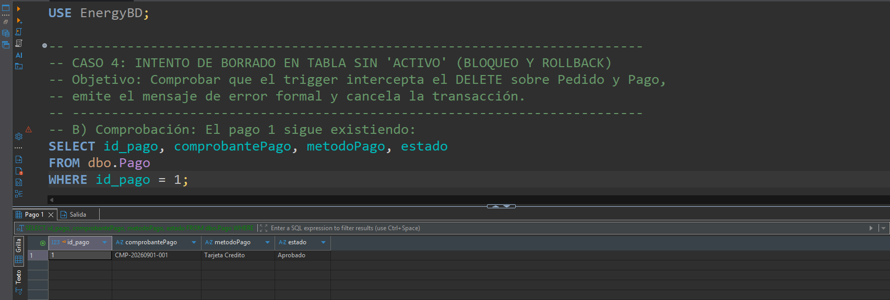

### 6.5 Auditoría de Ciclo de Vida de Pedidos (UPDATE)
Modificación del estado de una orden de compra ('Pendiente' a 'Pagado') y registro en la auditoría:
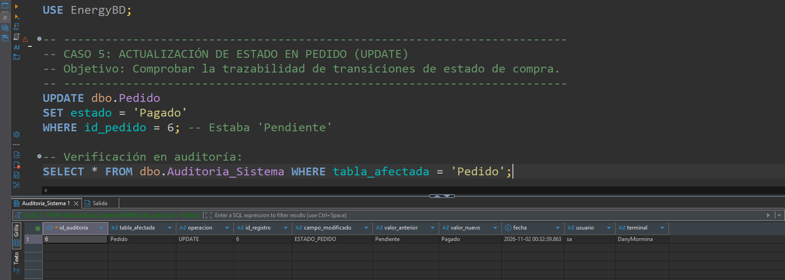

### 6.6 Reporte Consolidado de Trazabilidad
Consulta general a la tabla `Auditoria_Sistema` que evidencia el historial cronológico completo de altas, modificaciones, bajas lógicas y autoría (`DanyMormina`):
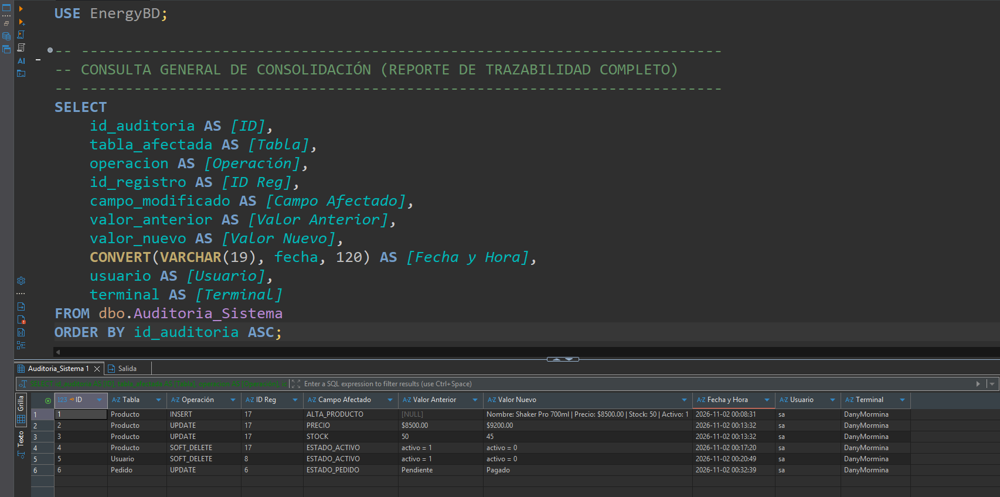

---

## Conclusión

El diseño e implementación de este esquema de triggers demostró que:
1. Es posible desacoplar la auditoría del software cliente, garantizando que el SGBD resguarde su propio historial con independencia de quién ejecute las consultas.
2. La combinación de triggers `AFTER` para monitoreo selectivo y triggers `INSTEAD OF` para políticas de borrado lógico y restricción asegura una base de datos íntegra, trazable y alineada a las mejores prácticas de la ingeniería de software.
